# Architecture & System Design Specification

## 1. System Overview

The **Continuous Insurance-to-Value (ITV) Intelligence Engine** is engineered as a clean, modular monolithic architecture designed for maintainability, zero-dependency local demonstrability, and seamless production readiness.

```mermaid
graph TD
    subgraph UI ["Frontend (React 18 / TypeScript / Vite / Tailwind CSS)"]
        Dashboard["Executive Dashboard & Drift Analysis"]
        Portfolio["Policy Portfolio & Detail Workspace"]
        Simulator["Scenario Simulator & Midterm/Renewal Workflow"]
        DataCentre["Data Integration Centre & Provenance Viewer"]
        Underwriter["Underwriter Review Workspace & Audit Log"]
    end

    subgraph API ["REST API Layer (Spring Boot 3 / Spring Web)"]
        AuthController["/api/v1/auth"]
        PolicyController["/api/v1/policies"]
        MonitoringController["/api/v1/monitoring"]
        EvidenceController["/api/v1/evidence"]
        ScenarioController["/api/v1/scenarios"]
        WorkflowController["/api/v1/workflows"]
        AnalyticsController["/api/v1/analytics"]
        IntegrationsController["/api/v1/integrations"]
    end

    subgraph Core ["Core Intelligence Engine (Spring Services)"]
        ITVEngine["ITV Engine & Drift Calculator"]
        ConfidenceEngine["Evidence Reliability & Hard-Abstention Engine"]
        ScenarioEngine["Hypothetical Scenario Simulator"]
        ContinuousMonitor["Continuous In-Force Monitoring Engine"]
        WorkflowEngine["Underwriter Case & Resolution State Machine"]
        AuditService["Tamper-Proof Audit Logger"]
    end

    subgraph DataIntegrations ["Data Integration Adapters"]
        MoSPIAdapter["MoSPI CPI Adapter (api.mospi.gov.in)"]
        DPIITAdapter["DPIIT WPI Material Adapter (Cement/Steel)"]
        CPWDAdapter["CPWD Plinth Area Rates 2025 Adapter"]
        GOBSAdapter["GOBS Building Footprint CSV.GZ Importer"]
        TNPWDAdapter["Tamil Nadu PWD Rates Adapter"]
    end

    subgraph Storage ["Relational Persistence & Migration"]
        Flyway["Flyway Migration Engine"]
        Database[("MySQL 8 / Relational Store\n(Indexed Schemas)")]
    end

    UI -->|REST / JSON with JWT| API
    API --> Core
    Core --> DataIntegrations
    Core --> Storage
    DataIntegrations --> Storage
    Flyway --> Database
```

---

## 2. Layered Architecture

### 2.1 Presentation Layer (Frontend)
- **Framework:** React 18+ with TypeScript in strict mode.
- **Build Tool:** Vite with optimized hot module replacement (HMR).
- **Styling:** Tailwind CSS with an enterprise color palette (Slate / Navy / Emerald / Amber / Rose / Indigo) suitable for insurance operations.
- **Routing:** React Router DOM v6 with role-based route guards (`ADMIN`, `UNDERWRITER`, `REVIEWER`, `VIEWER`).
- **Data Visualization:** Recharts for historical ITV drift lines, breakdown bar charts, and confidence radar charts.
- **Icons & Ergonomics:** Lucide React icons, accessible tables with sorting, filtering, and pagination.

### 2.2 API & Security Layer (Backend)
- **REST APIs:** Spring Boot 3 Controllers exposing JSON resources with HTTP status semantics (200 OK, 201 Created, 400 Bad Request, 401 Unauthorized, 403 Forbidden, 404 Not Found, 409 Conflict).
- **DTO Projection:** Strict separation between JPA entities and API transfer objects. Entities are never exposed directly to external clients.
- **Authentication:** Stateless JSON Web Token (JWT) with HMAC-SHA256 signature, signed with an application secret, validating user roles and expiry.
- **Security Filter Chain:** Spring Security 6 filter chain enforcing granular role-based permissions on endpoint verbs.

### 2.3 Core Intelligence Services
1. **ITV Calculation Service:**
   - Evaluates dwelling coverage against the latest verified rebuilding cost estimate.
   - Computes dollar/rupee gap and drift from previous snapshots.
   - Assigns policy classification: `ADEQUATE` ($\ge 95\%$), `WATCH` ($90 - 94.99\%$), `WARNING` ($80 - 89.99\%$), and `CRITICAL` ($< 80\%$).
2. **Evidence Reliability & Abstention Engine:**
   - Implements multi-dimensional heuristic scoring:
     $$C = 0.30 \cdot S + 0.25 \cdot F + 0.20 \cdot K + 0.25 \cdot A$$
   - Executes **Hard Abstention Rules** preventing false confidence when:
     - Disagreement between independent estimates exceeds $20\%$.
     - Evidence age exceeds staleness threshold ($> 365$ days for construction indices).
     - Critical building characteristics (built-up area, construction type) are missing.
     - Units or currencies mismatch.
3. **Continuous In-Force Monitoring Engine:**
   - **Scheduled Daily Evaluation:** Spring `@Scheduled(cron = "0 0 2 * * ?")` re-evaluates all active policies.
   - **Event-Driven Evaluation:** Spring Application Events triggered when external rate tables, GOBS footprint imports, or renovation reports arrive.
   - **Manual Evaluation:** Authorized underwriter on-demand reassessment via REST endpoint.
   - **Idempotency & Snapshots:** Never mutates or deletes historical snapshots; creates timestamped audit entries.
4. **Scenario Simulation Engine:**
   - Pure functional recalculation engine projecting coverage limits (80%, 90%, 95%, 100%, and custom amounts) without modifying database policy state.
5. **Underwriter Review & Workflow Engine:**
   - State machine governing review cases: `OPEN` $\rightarrow$ `UNDER_REVIEW` $\rightarrow$ `EVIDENCE_REQUESTED` $\rightarrow$ `APPROVED` / `REJECTED` / `ESCALATED` $\rightarrow$ `RESOLVED`.
   - Distinguishes **Midterm Endorsements** from **Renewal Adjustments**.

### 2.4 External Data Integration Layer
- Implements the Adapter Pattern for heterogeneous Indian public data sources:
  - `MoSPICpiClient`: Queries `/api/cpi/getCPIIndex` on `https://api.mospi.gov.in`.
  - `DpiitWpiClient`: Parses cement and structural steel price indices.
  - `CpwdPar2025Client`: Applies CPWD Plinth Area Rates 2025 residential RCC rates adjusted for Tamil Nadu cost index multipliers.
  - `GobsImporter`: Streams `.csv` or `.csv.gz` building stock data from AEEE GOBS.
  - Every external record stores strict provenance: `source_name`, `source_url`, `publication_date`, `retrieval_date`, `provenance_category`, and `is_verified`.

---

## 3. Database & Persistence Strategy

- **Schema Management:** Flyway database migrations (`V1__init_schema.sql`, `V2__seed_demo_data.sql`).
- **Relational Integrity:** Foreign keys on all parent-child hierarchies (`properties` $\rightarrow$ `policies` $\rightarrow$ `coverage_snapshots`, `monitoring_evaluations`, `review_cases`).
- **Indexes:** Composite indexes on `(policy_id, evaluation_date)`, `(status, itv_classification)`, `(property_id, created_at)`.
- **Auditability:** Dedicated `audit_logs` table recording timestamp, username, action, entity type, entity ID, previous state, new state, and IP address.

