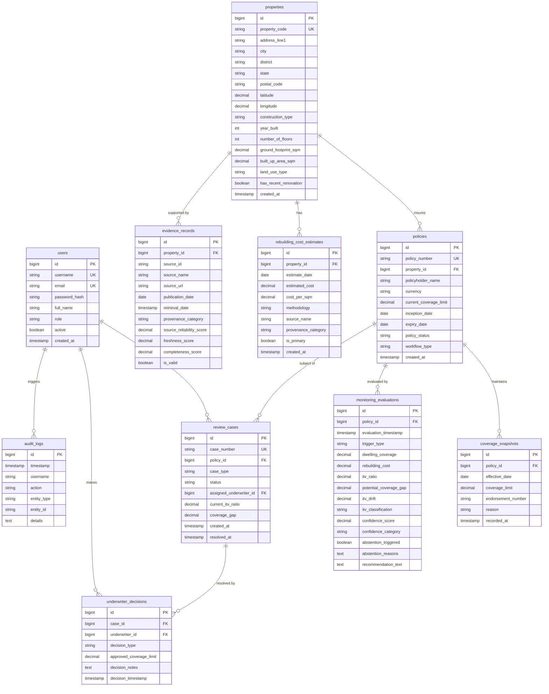

# Entity-Relationship (ER) Diagram

---

## Key Relational Integrity Guarantees
1. **Cascade & Deletion Safety:** Policies and coverage snapshots have `ON DELETE RESTRICT` constraints to prevent accidental erasure of regulatory insurance contracts.
2. **Temporal Integrity:** `coverage_snapshots`, `monitoring_evaluations`, and `audit_logs` are strictly append-only. No `UPDATE` queries are ever issued against historical snapshot records.
3. **Traceability:** Every `underwriter_decision` links to an open `review_case` and records the responsible `user_id` and timestamp, guaranteeing complete accountability.
